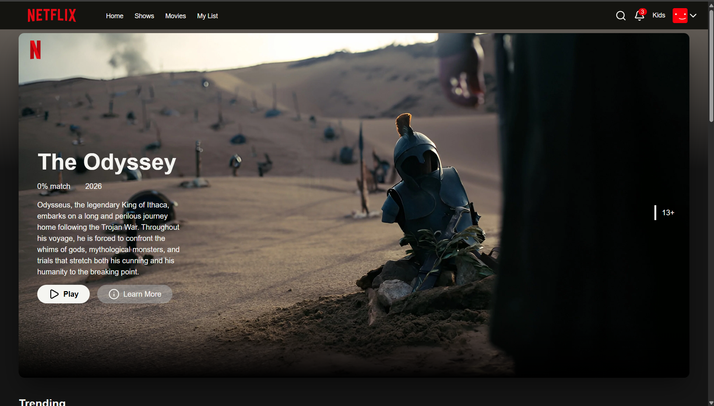
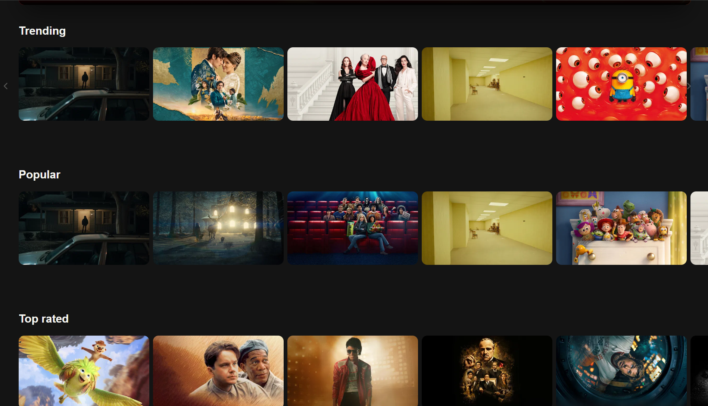
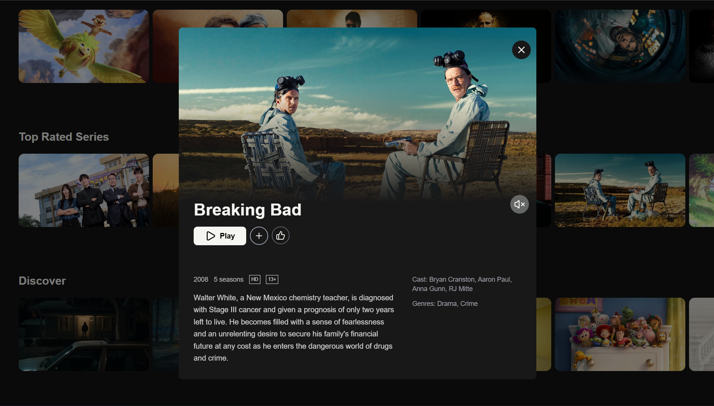
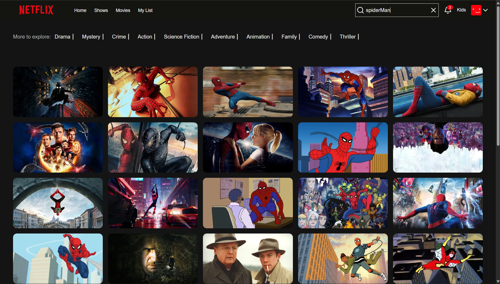

# MovieDB Explorer
 
A full-stack, Netflix-inspired streaming app. The **React** front end browses live movie and TV data from the **TMDB API**, and an **Express + MongoDB** back end handles user accounts and saves each user's **My List**.
 
**[Live Demo](https://movie-database-black-eight.vercel.app/)** · React · Express · MongoDB · TMDB
 
## Screenshots
 
| Home / Hero | Category Rows |
|:---:|:---:|
|  |  |
| **Detail Modal** | **Search** |
|  |  |
 
## Features
 
**Browsing**
- **Dynamic hero banner** — a random trending title with an autoplaying trailer on hover and an ambient background color sampled from the artwork (`fast-average-color`).
- **Category rows** — horizontally scrollable carousels generated per category (Popular, Trending, Top Rated, etc.).
- **Card hover preview** — trailer playback plus a quick-actions panel (Play, add to My List, Like, more info).
- **URL-driven detail modal** — opens on `?item=<id>&type=<movie|tv>`, so it overlays any page and is shareable and refreshable. Shows trailer, cast, genres, runtime/seasons, and rating. Closes with the ✕, a backdrop click, or `Escape`, with background scroll locked.
- **Search** — live multi-search (movies + shows) with a results grid and genre banner.
**Accounts**
- **Register and log in** — passwords are hashed with bcrypt; login returns a JWT that expires after 30 minutes.
- **Protected routes** — pages that need an account redirect to login, and an expired or invalid token logs the user out automatically.
- **My List** — add and remove titles, saved per user in MongoDB, with a dedicated empty state.
**UI quality**
- **Loading skeletons** — composed from a reusable `SkeletonBox` (grid / row / hero / modal variants).
- **Error boundaries** — a failing section shows an error card instead of crashing the whole page.
- **Responsive navbar** — collapsible menus, animated search input, and a dark theme throughout.
## Architecture
 
```
React app (Vercel) ──► TMDB API          movie & TV data, called directly from the browser
        │
        └────────────► Express API (Render) ──► MongoDB
                       accounts, JWT auth, My List
```
 
## Tech Stack
 
| Area | Tools |
|------|-------|
| Front end | React 19, Vite 8, React Router v7 |
| Styling | Tailwind CSS v4 |
| HTTP client | Axios (interceptors attach the JWT and handle expired sessions) |
| Back end | Node.js, Express 5 |
| Database | MongoDB with Mongoose |
| Auth | bcrypt, JSON Web Tokens |
| Data | [TMDB API](https://developer.themoviedb.org/) |
| Media & icons | react-player, lucide-react, react-icons |
| Hosting | Vercel (front end), Render (API) |
 
## Project Structure
 
```
Movie-database/
├── moviedb-explorer/   # React front end
├── api/                # Express API
└── screenshots/        # images used in this README
```
 
## Getting Started
 
### Prerequisites
- [Node.js](https://nodejs.org/) 20.19 or newer
- A free [TMDB API key](https://www.themoviedb.org/settings/api)
- A MongoDB connection string (e.g. a free [MongoDB Atlas](https://www.mongodb.com/atlas) cluster)
### 1. Clone the repo
 
```bash
git clone https://github.com/LenielMojica/Movie-database.git
cd Movie-database
```
 
### 2. Start the API
 
```bash
cd api
npm install
```
 
Create `api/.env`:
 
```env
MONGO_URI=your_mongodb_connection_string
JWT_SECRET=a_long_random_string
PORT=3000
```
 
```bash
npm start
```
 
### 3. Start the front end
 
In a second terminal:
 
```bash
cd moviedb-explorer
npm install
```
 
Create `moviedb-explorer/.env`:
 
```env
VITE_API_KEY=your_tmdb_api_key_here
VITE_API_URL=http://localhost:3000
```
 
```bash
npm run dev
```
 
Open http://localhost:5173. The API only accepts requests from this address and the deployed site (CORS).
 
> Vite exposes only variables prefixed with `VITE_`, and they are embedded in the client bundle, so they are publicly visible in the browser. Secrets like `JWT_SECRET` and `MONGO_URI` stay on the server.
 
## API Endpoints
 
| Method | Route | Auth | Description |
|--------|-------|:----:|-------------|
| `POST` | `/register` | — | Create an account (`{ user, password }`) |
| `POST` | `/login` | — | Returns a JWT (`{ token }`) |
| `GET` | `/myList` | ✓ | Get the user's saved titles |
| `POST` | `/myList` | ✓ | Add a title (duplicates are ignored) |
| `DELETE` | `/myList/:id` | ✓ | Remove a title by its TMDB id |
 
Authenticated routes expect an `Authorization: Bearer <token>` header.
 
## Available Scripts
 
**Front end** (`moviedb-explorer/`)
 
| Script | Description |
|--------|-------------|
| `npm run dev` | Start the Vite dev server |
| `npm run build` | Build for production into `dist/` |
| `npm run preview` | Preview the production build locally |
| `npm run lint` | Run ESLint |
 
**API** (`api/`)
 
| Script | Description |
|--------|-------------|
| `npm start` | Start the server, loading variables from `.env` |
 
## License
 
This project is for educational and portfolio purposes. Movie data and images are provided by [TMDB](https://www.themoviedb.org/); this product uses the TMDB API but is not endorsed or certified by TMDB.
